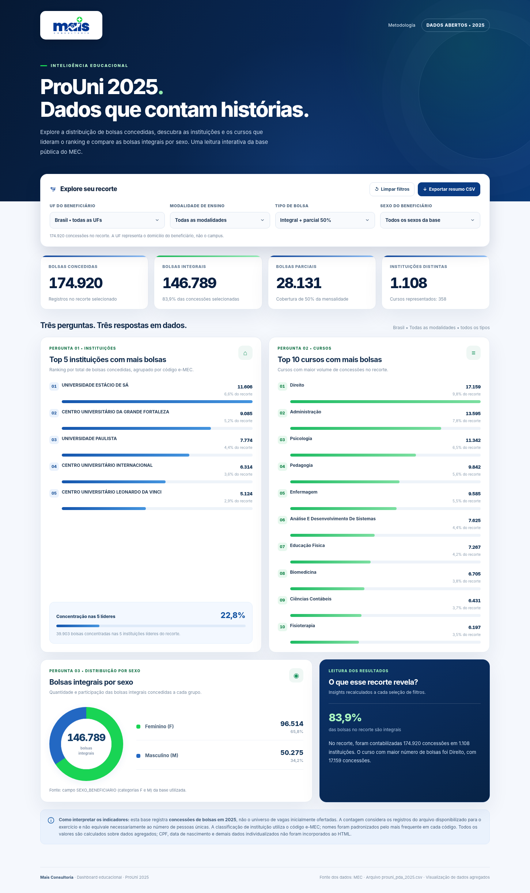
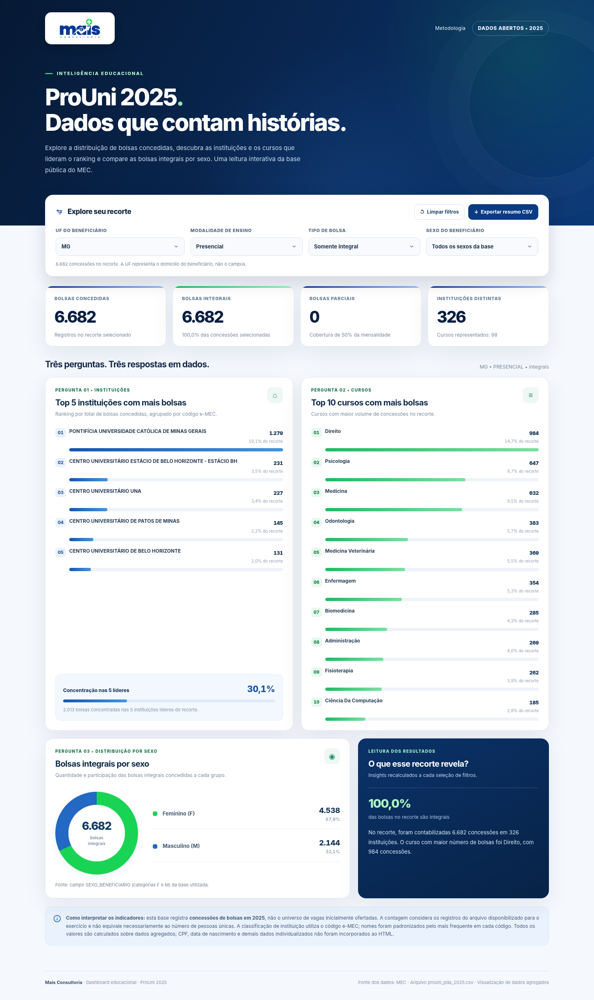
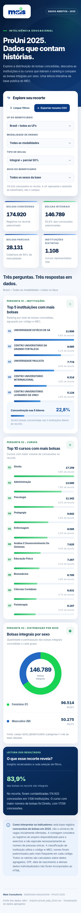

[README.md](https://github.com/user-attachments/files/33577856/README.md)
# Dashboard ProUni 2025 | Mais Consultoria

Dashboard interativa em **HTML, CSS e JavaScript**, desenvolvida como adaptação do desafio da [Digital Innovation One (DIO)](https://digitalinnovationone.github.io/dashboard_porsche_sales/) sobre publicação de dashboards no GitHub Pages. Em lugar da base de vendas de carros, este projeto utiliza a **base de bolsas concedidas do ProUni em 2025, do MEC**, fornecida para o exercício.

O projeto aplica conceitos de análise exploratória, tratamento de dados, construção de indicadores, visualização e publicação web. Identidade visual: **Mais Consultoria** (azul e verde).



> **Atenção à definição do indicador:** a variável do arquivo é `ANO_CONCESSAO_BOLSA`. Por isso, os gráficos mostram **bolsas concedidas**, e não todas as bolsas **ofertadas**. Cada registro do arquivo é contabilizado como uma concessão; não se presume que seja uma pessoa única.

## Acesse a dashboard

**[Abrir dashboard publicada](https://SEU-USUARIO.github.io/dashboard-prouni-2025/)** ← substitua `SEU-USUARIO` após ativar o GitHub Pages.

## Perguntas de negócio

1. **Quais são as cinco instituições de ensino superior com mais bolsas concedidas?** O ranking evidencia a concentração de concessões entre as IES. A instituição é identificada pelo **código e-MEC**, evitando somar instituições diferentes que eventualmente compartilhem nome.
2. **Quais são os dez cursos com mais bolsas concedidas?** Permite identificar as áreas de formação com mais registros de concessão e observar como o ranking muda com os filtros.
3. **Como se distribuem as bolsas integrais por sexo dos beneficiários?** Compara os totais **F** e **M**, exatamente como registrados na coluna `SEXO_BENEFICIARIO` da base.

Os três painéis são atualizados de forma sincronizada quando os filtros mudam.

## Indicadores e filtros

**Indicadores de topo:** bolsas concedidas, bolsas integrais, bolsas parciais (50%), número de instituições e informação adicional de número de cursos.

**Filtros:** UF do beneficiário, modalidade de ensino (presencial/EAD), tipo de bolsa (integral/parcial 50%) e sexo (F/M). Há botões para limpar os filtros e **exportar o resumo agregado em CSV**. O filtro de UF utiliza `UF_BENEFICIARIO`, portanto **não indica o estado do campus ou da sede da instituição**.

**Resultados nacionais (sem filtros):**

| Medida | Total |
| --- | ---: |
| Bolsas concedidas | 174.920 |
| Bolsas integrais | 146.789 |
| Bolsas parciais (50%) | 28.131 |
| Instituições distintas (código e-MEC) | 1.108 |
| Cursos distintos (incluindo a categoria não informado) | 358 |
| Integrais – sexo F | 96.514 |
| Integrais – sexo M | 50.275 |

## Base de dados e tratamento

- **Fonte:** arquivo `prouni_pda_2025(1).csv`, associado à base aberta ProUni/MEC 2025 e disponibilizado para o exercício.
- **Formato de entrada:** CSV UTF-8, separado por ponto e vírgula; **174.920 registros** e 18 colunas na origem.
- **Campos usados:** `ANO_CONCESSAO_BOLSA`, `CODIGO_EMEC_IES_BOLSA`, `NOME_IES_BOLSA`, `UF_BENEFICIARIO`, `MODALIDADE_ENSINO_BOLSA`, `TIPO_BOLSA`, `NOME_CURSO_BOLSA`, `SEXO_BENEFICIARIO`.
- **Limpeza aplicada:** remoção de espaços excedentes; categorização das **30 linhas sem nome de curso** como *Curso não informado*; identificação das IES pelo código e-MEC; quando havia mais de um nome para um código, selecionou-se o nome mais frequente no arquivo.
- **Transformação:** totalização das concessões por UF do beneficiário, modalidade, tipo, sexo e IES; segunda totalização por UF do beneficiário, modalidade, tipo, sexo e curso. Isso permite filtrar dinamicamente sem colocar os 174.920 registros individuais no navegador.
- **Verificação:** os totais das duas agregações coincidem com as 174.920 linhas da base; as contagens nacionais de bolsas integrais por F/M também foram verificadas.
- **Privacidade:** colunas como **CPF, data de nascimento e informações individuais não entram** no HTML. Por esse motivo, **o CSV original não foi enviado ao repositório**. O código entrega apenas agregações necessárias aos gráficos.
- **Interpretação:** não foi aplicada deduplicação automática; linhas semelhantes podem representar concessões distintas. A base de concessões não permite inferir, isoladamente, o total de vagas ofertadas ou de pessoas únicas.

## Prompt utilizado no desenvolvimento

A seguir, uma versão organizada do pedido de criação desta dashboard (adaptada do briefing do desafio):

```text
Crie uma dashboard responsiva e interativa em um único arquivo index.html,
sem dependências externas, usando a base do MEC de bolsas concedidas pelo
ProUni em 2025 e a logo da Mais Consultoria.

Perguntas de negócio:
1. Ranking das 5 instituições de ensino superior com mais bolsas concedidas.
2. Ranking dos 10 cursos com mais bolsas concedidas.
3. Total de bolsas integrais por sexo do beneficiário (F e M).

Inclua filtros por UF do beneficiário, modalidade, tipo de bolsa e sexo,
além de indicadores de topo: total, integrais, parciais e número de IES.
Use as cores azul e verde da Mais Consultoria e o dashboard Porsche da DIO
como referência de organização, não de conteúdo.

Trate adequadamente valores ausentes e nomes de instituições, mantenha
os indicadores e gráficos sincronizados e proteja os dados pessoais:
incorpore no HTML somente contagens agregadas, jamais CPFs ou datas de
nascimento. Não trate bolsas concedidas como bolsas ofertadas.
O resultado deve abrir localmente e no GitHub Pages, inclusive em celular.
```

**Refinamentos aplicados até a versão final:**

- Correção metodológica de *ofertadas* para **concedidas**, conforme a variável da base;
- Agrupamento de instituições pelo código e-MEC e manutenção dos nomes de cursos sem preenchimento em uma categoria separada;
- Inclusão da concentração das cinco instituições líderes, dos percentuais por sexo e de mensagens para recortes sem bolsas integrais;
- Inclusão de filtros sincronizados, opção de limpar filtros e exportar CSV agregado;
- Incorporação da logo ao próprio HTML, cores azul/verde e layout responsivo;
- Testes dos totais, filtros, exportação e visualização em desktop e dispositivos móveis.

**Ferramentas:** ChatGPT para construção e refinamento da dashboard, scripts para preparação/agregação dos dados e HTML/CSS/JavaScript para a interface final. Se você também elaborou uma versão separada no Canvas ou em agente com skill própria, poderá documentar e comparar esse segundo percurso nesta seção.

## Exemplo de filtro aplicado

Neste exemplo, os rankings e indicadores estão filtrados por **MG + presencial + bolsa integral**.



Versão em tela pequena:



## Estrutura do repositório

```text
dashboard-prouni-2025/
├── index.html                 # Dashboard autossuficiente; abre offline
├── README.md                  # Objetivo, perguntas e preparação de dados
├── preview_dashboard.png      # Evidência: painel com dados nacionais
├── preview_filtro_mg.png      # Evidência: painel com filtros ativos
└── preview_mobile.png         # Evidência: layout responsivo
```

## Publicação no GitHub Pages

1. Crie o repositório público `dashboard-prouni-2025` (nome sugerido).
2. Envie `index.html`, `README.md` e as três imagens **para a raiz** do repositório.
3. Acesse **Settings → Pages → Build and deployment**; em **Source**, escolha **Deploy from a branch**, branch **main**, pasta **/(root)** e salve.
4. Aguarde a ativação e abra `https://SEU-USUARIO.github.io/dashboard-prouni-2025/`.
5. Substitua o endereço de exemplo acima pelo URL real da sua dashboard publicada.
6. Na submissão da DIO, envie **o endereço do repositório**, não apenas o endereço do site.

> O arquivo `index.html` já contém todos os dados agregados, o CSS, o JavaScript e a logo: **não depende de outros arquivos ou bibliotecas para funcionar.**

## Referência do desafio

Dashboard de exemplo do professor: [Porsche Sales Intelligence – DIO](https://digitalinnovationone.github.io/dashboard_porsche_sales/).

---

**Projeto de estudo / portfólio** · Mais Consultoria · Dados educacionais ProUni/MEC 2025.
